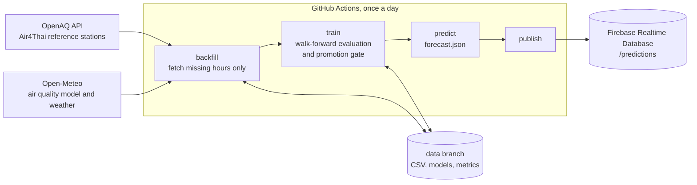

# Bangkok PM2.5 and PM10 Forecast

A daily pipeline that collects public air quality and weather data, forecasts PM2.5 and PM10 for Bangkok, and publishes the forecast to Firebase Realtime Database through GitHub Actions.

It forecasts today and tomorrow as daily means, and the next three calendar months as monthly means with a range.

## Architecture



| Module | Responsibility |
|---|---|
| `pm25.ingest` | Fetches only the hours missing locally, stores them as UTC CSV, never duplicates a row |
| `pm25.features` | Builds daily targets and features that only use information known at forecast time |
| `pm25.evaluate` | Walk-forward splits, metrics and the promotion gate |
| `pm25.train` | Compares models with baselines and decides what each forecast slot publishes |
| `pm25.predict` | Builds the forecast document |
| `pm25.publish` | Writes the document to Firebase in one atomic request |

## Live dashboard

- Main: https://app-pm25-forecast-1716.azurewebsites.net (Azure App Service, free F1 plan)
- Backup: https://stpm25webd0b881.z23.web.core.windows.net (Azure Blob Storage static website)

Pages: the forecast with Thai air quality colours (PCD scale) and a station map, and `/accuracy/` with live accuracy. Both have Thai and English text (`?lang=th` or `?lang=en`, or the switch at the top).

Both sites serve the same Next.js static export from `web/` (TypeScript, React, Chart.js). The page is plain files with no server, and it fetches the `data` branch in the browser, so each morning's forecast appears without a rebuild. Types in `web/lib/types.ts` mirror the forecast document, so a schema change on the Python side fails the TypeScript build. `deploy-dashboard-pages.yml` publishes the same build to GitHub Pages once Azure is removed.

To work on the dashboard locally:

```bash
cd web
npm ci
npm run dev      # http://localhost:3000
npm test
npm run build    # static files in web/out
```

## Azure resources

Everything lives in one resource group, `rg-pm25-forecast`, on an Azure for Students subscription, so it can be deleted in one step without affecting the pipeline.

| Resource | Purpose | Cost |
|---|---|---|
| Azure SQL Database, free tier, serverless | Warehouse with `bronze`, `silver` and `gold` schemas and views for Power BI | Free; pauses instead of billing when the monthly allowance is used |
| App Service plan F1 and web app | Main dashboard | Free |
| Storage account, static website | Backup dashboard | Free for 12 months, then a few cents |
| User-assigned managed identity | GitHub Actions signs in with OIDC, scoped to these resources only | Free |

The database accepts Microsoft Entra sign-in only. CI opens the SQL firewall for its own address during the load and removes the rule afterwards. Azure steps never block the forecast or the Firebase publish.

## Data

| Source | Role | Data | Access |
|---|---|---|---|
| OpenAQ, Air4Thai reference monitors | Forecast target | Hourly PM2.5 at 10 stations and PM10 at 3 stations | Free API key |
| Open-Meteo Air Quality | Feature | PM2.5, NO2, O3, SO2 and CO from the CAMS global model | No key |
| Open-Meteo Historical Weather | Feature, and the target for temperature and humidity | Temperature, humidity, precipitation and wind from 2021 | No key |
| TMD Weather Forecast API | Reference shown next to our forecast | Hourly temperature and humidity forecast, 3 km model | Free token |
| NASA FIRMS (VIIRS S-NPP) | Feature, optional | Daily fire detection count and total fire radiative power in a box over central Thailand, western Cambodia and the Myanmar border (97.5–105.5 E, 11.5–17.5 N) | Free MAP_KEY |

The daily target is the median across a fixed panel of stations, so one faulty station cannot move it. A station-day needs 18 hours of data, and a city-day needs at least 5 PM2.5 stations or 2 PM10 stations. Days are Bangkok local days. Gaps in the measured target are never filled with model data.

Modelled PM10 from Open-Meteo is not used, because its ratio to PM2.5 changes abruptly in November 2024.

Fire detections are stored as hourly totals (count and FRP), not single detections, so the file stays small. Archive (standard processing) data is used where it exists and near real time data after it. Days that were never fetched stay missing rather than zero. The fire features only reach a published forecast if a model trained with them passes the promotion gate. Each promoted model records its feature list, so models saved before the fire features existed keep working.

## Run locally

### Requirements

Python 3.12 or newer. Library versions are pinned in `requirements.txt`, so every install gets the same versions.

| Library | Used for |
|---|---|
| pandas, numpy | Data handling |
| scikit-learn, joblib | Models and saving them |
| matplotlib | Evaluation plot and PDF report |
| requests | Calls to OpenAQ, Open-Meteo and Firebase |
| google-auth | Service account login for Firebase publishing |
| pytest | Tests (`requirements-dev.txt`) |

### Install

macOS or Linux:

```bash
python3.12 -m venv .venv
source .venv/bin/activate
pip install -r requirements.txt -r requirements-dev.txt
pip install -e . --no-deps
pytest
```

Windows (PowerShell):

```powershell
py -3.12 -m venv .venv
.venv\Scripts\Activate.ps1
pip install -r requirements.txt -r requirements-dev.txt
pip install -e . --no-deps
pytest
```

If PowerShell refuses to run the activation script, allow local scripts for your user once:

```powershell
Set-ExecutionPolicy -Scope CurrentUser RemoteSigned
```

The last install line makes the `pm25` package and its `python -m pm25` commands available. On macOS and Linux, `make install` and `make test` do the same.

### Run

Create your settings file, then open `.env` and fill in the values. Commands read `.env` automatically, so there is nothing to load by hand.

macOS or Linux:

```bash
cp .env.example .env
```

Windows (PowerShell):

```powershell
Copy-Item .env.example .env
```

Then run the pipeline with the virtual environment active. These commands are the same on every platform:

```bash
python -m pm25 backfill
python -m pm25 train
python -m pm25 predict
python -m pm25 report
python -m pm25 monitor   # score published forecasts against measurements
python -m pm25 health    # exit 1 if today's outputs are stale or failing
python -m pm25 publish
```

`publish` is optional and needs Firebase credentials. On macOS and Linux, `make pipeline` runs backfill, train, predict and report in one go. Values already set in the shell or in CI take priority over `.env`.

The first OpenAQ load takes about 30 minutes because requests are paced for the free tier. Later runs only fetch new hours.

## Automation

`.github/workflows/daily-forecast.yml` runs the pipeline every morning and can also be started by hand (`workflow_dispatch`).

| Setting | Value |
|---|---|
| Schedule | 00:17 UTC, which is 07:17 in Bangkok; GitHub may start it some minutes late |
| Overlap | A concurrency group stops two runs overlapping |
| Timeout | 60 minutes |
| State | Data, models and reports live on a `data` branch that always holds a single commit |
| Daily report | Markdown, CSV and PDF in the run summary and the `daily-report-<date>` artifact, kept 30 days |
| Report history | `reports/<date>.md` and `reports/forecast_history.csv` on the `data` branch |
| Model artifacts | Model, registry and metrics, kept 7 days |

Repository secrets: `OPENAQ_API_KEY`, `TMD_API_TOKEN` (optional), `FIRMS_MAP_KEY` (optional), `FIREBASE_DB_URL` and `FIREBASE_SERVICE_ACCOUNT_JSON` (the JSON key of a service account with the Firebase Realtime Database Admin role).

### Live accuracy and alerts

`python -m pm25 monitor` runs after the report. It joins every published daily forecast in `gold/forecast_history.csv` with the measured value once it exists, and compares it with persistence as it stood on the day the forecast was issued. It writes `gold/live_accuracy.csv` (one row per scored forecast) and `gold/live_accuracy_summary.json` (MAE, persistence MAE, skill and range coverage over 7, 30 and 90 days). If the published forecast for a target is worse than persistence over 30 days with at least 14 scored days, the summary carries an alert.

`.github/workflows/health-check.yml` runs at 10:37 Bangkok time on the `data` branch. It raises an alert when no forecast was published today, the newest complete station day is more than two days old, the data quality gate failed, or the live accuracy summary carries an alert. An alert opens a GitHub issue labelled `pipeline-health` (or comments on the open one), which emails the repository owner; the next healthy run closes it. GitHub also emails the owner when a scheduled run fails.

`python -m pm25 alert` is a scaffold for public alerts when tomorrow's PM2.5 is above the Thai standard. See [docs/alerts.md](docs/alerts.md).

Cost and limits for a public repository: GitHub-hosted standard runners are free with no minute limit. Scheduled runs can start late when GitHub is busy, and GitHub disables schedules in public repositories after 60 days without repository activity. Artifacts can be kept up to 90 days; this workflow keeps them 7.

Recommended Realtime Database rules, which let anyone read forecasts and nobody write except the service account:

```json
{
  "rules": {
    ".read": false,
    ".write": false,
    "predictions": { ".read": true, ".write": false }
  }
}
```

## Forecast document

`/predictions/latest` and `/predictions/history/<date>` hold the same document:

```json
{
  "schema_version": 1,
  "as_of": "2026-11-11",
  "latest_data_date": "2026-11-10",
  "data_age_days": 0,
  "status": "ok",
  "units": "ug/m3",
  "daily": [
    {"date": "2026-11-12", "label": "tomorrow", "pm25": 21.1, "pm25_low": 13.7, "pm25_high": 28.5, "pm25_method": "random_forest", "pm10": 34.6, "...": "..."}
  ],
  "monthly": [
    {"month": "2026-12", "months_ahead": 1, "pm25": 30.0, "pm25_low": 25.0, "pm25_high": 35.0, "pm25_method": "climatology", "...": "..."}
  ]
}
```

`status` becomes `stale` and values become `null` when the latest station data is older than the forecast origin. The range covers 80 % of past out-of-sample errors.

## Model card

### What each forecast uses

Each target and horizon is a slot. A slot publishes a fitted model only after the model passes the promotion gate; otherwise it publishes the best baseline. The gate runs daily, so the published method can change. The table shows the run of 2026-11-11.

| Slot | Published method |
|---|---|
| PM2.5 today | Gradient boosting |
| PM2.5 tomorrow | Random forest |
| PM10 today and tomorrow | Random forest |
| Temperature and humidity today | Persistence (yesterday's value) |
| Temperature and humidity tomorrow | Random forest |
| Monthly PM2.5 and PM10, 1 to 3 months ahead | Climatology (mean of the same calendar month) |
| Monthly temperature and humidity | Climatology or damped anomaly, whichever passes the gate |

Temperature and humidity are trained and scored against Open-Meteo history from 2021, which is a model reanalysis and not a station measurement. Compared with station records from 2023 to 2026, it reads about 1 °C cooler than central Bangkok. Measured temperature that is free and updated daily was not found.

The Thai Meteorological Department (TMD) forecast for today and tomorrow is published next to ours as `tmd_*` fields. It is an independent 3 km weather model, and its accuracy against Bangkok stations has not been measured here.

### How it is evaluated

- Walk-forward, expanding window, never shuffled. The first test block starts one year after the data begins. Each 30-day block is predicted by a model trained only on rows whose outcome was known before the block started.
- Every method is scored on the same rows, so a method cannot look better by skipping hard days.
- Baselines: persistence (yesterday), seven-day seasonal naive (same weekday last week), and for monthly forecasts, climatology.
- Promotion gate: a candidate must cut MAE by at least 1 % against every baseline over the latest 90 days and over all folds. If a model is already published, the candidate must also beat it on days that model never trained on, and at least 14 such days must exist.
- Tests check that no feature uses data after its forecast origin and that walk-forward training never sees a test-period outcome.

### Results

Out-of-sample walk-forward results from the 2026-11-11 run. Air quality slots cover about 1,150 days and weather slots about 1,650 days, ending November 2026. Skill is the share of persistence error removed.

| Slot | Best model | MAE | RMSE | R² | Persistence MAE | Skill |
|---|---|---|---|---|---|---|
| PM2.5 today (µg/m³) | Gradient boosting | 3.21 | 4.61 | 0.81 | 3.45 | 7 % |
| PM2.5 tomorrow (µg/m³) | Random forest | 4.64 | 6.52 | 0.63 | 5.28 | 12 % |
| PM10 today (µg/m³) | Random forest | 4.81 | 6.78 | 0.81 | 4.89 | 2 % |
| PM10 tomorrow (µg/m³) | Random forest | 6.89 | 9.46 | 0.62 | 7.47 | 8 % |
| Temperature today (°C) | Random forest, not published | 0.59 | 0.78 | 0.79 | 0.59 | 1 % |
| Temperature tomorrow (°C) | Random forest | 0.83 | 1.07 | 0.59 | 0.86 | 3 % |
| Humidity today (%) | Random forest, not published | 3.50 | 4.68 | 0.82 | 3.44 | −2 % |
| Humidity tomorrow (%) | Random forest | 4.81 | 6.37 | 0.66 | 4.89 | 2 % |

PM2.5 tomorrow by season of the target date (MAE, model against persistence): cool haze season November to February 7.0 against 8.4, hot season March to May 5.7 against 5.8, rainy season June to October 2.7 against 3.2.

Monthly errors over 25 to 27 out-of-sample months for air quality and about 40 months for weather: MAE 2.8 to 3.0 µg/m³ for PM2.5, 4.4 to 4.5 µg/m³ for PM10, 0.8 °C for temperature and 3.5 to 3.7 % for humidity.

For context, the Open-Meteo CAMS value for the same day, which is hindsight rather than a forecast, has a PM2.5 MAE of 11.0 against the station panel. The model reads high for Bangkok.

### Limitations

- The better of two candidate models is picked on the same walk-forward results that are reported, so the reported model error is slightly optimistic.
- R² is flattered by the strong seasonal cycle. Skill against persistence is the more honest number, and it is small for the same-day forecast.
- About five years of station data contain only five cool seasons, so monthly forecasts cannot learn much beyond the seasonal average.
- PM10 rests on three stations and represents the city less well than PM2.5.
- Recent Open-Meteo weather is preliminary and may be revised. Training uses revised history, so live inputs are slightly noisier than training inputs.
- The station panel is fixed. If stations stop reporting for long, the city value is missing rather than estimated.
- Burning-season smoke from outside Bangkok is not modelled directly. Fire activity data could be added later.

## Data sources and attribution

Station data from [OpenAQ](https://openaq.org), originally published by Thailand's Pollution Control Department (Air4Thai). Weather and modelled air quality from [Open-Meteo](https://open-meteo.com), licensed CC BY 4.0. Check each provider's terms before reusing the data.
