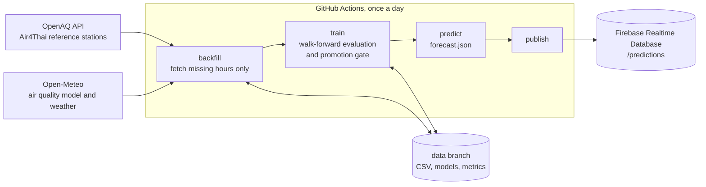

# Bangkok PM2.5 and PM10 Forecast

A daily pipeline that collects public air quality and weather data, forecasts PM2.5 and PM10 for Bangkok, and publishes the forecast to Firebase Realtime Database through GitHub Actions.

It forecasts today and tomorrow as daily means, and the next three calendar months as monthly means with a range.

## Architecture



| Module | Responsibility |
|---|---|
| `pm25.ingest` | Fetches only the hours missing locally, stores them as UTC CSV, never duplicates a row |
| `pm25.features` | Builds daily targets and features that only use information known at forecast time |
| `pm25.evaluate` | Walk-forward splits, metrics and the promotion gate |
| `pm25.train` | Compares models with baselines and decides what each forecast slot publishes |
| `pm25.predict` | Builds the forecast document |
| `pm25.publish` | Writes the document to Firebase in one atomic request |

## Data

| Source | Role | Data | Access |
|---|---|---|---|
| OpenAQ, Air4Thai reference monitors | Forecast target | Hourly PM2.5 at 10 stations and PM10 at 3 stations | Free API key |
| Open-Meteo Air Quality | Feature | PM2.5, NO2, O3, SO2 and CO from the CAMS global model | No key |
| Open-Meteo Historical Weather | Feature | Temperature, humidity, precipitation and wind | No key |

The daily target is the median across a fixed panel of stations, so one faulty station cannot move it. A station-day needs 18 hours of data, and a city-day needs at least 5 PM2.5 stations or 2 PM10 stations. Days are Bangkok local days. Gaps in the measured target are never filled with model data.

Modelled PM10 from Open-Meteo is not used, because its ratio to PM2.5 changes abruptly in November 2024.

## Run locally

### Requirements

Python 3.12 or newer. Library versions are pinned in `requirements.txt`, so every install gets the same versions.

| Library | Used for |
|---|---|
| pandas, numpy | Data handling |
| scikit-learn, joblib | Models and saving them |
| matplotlib | Evaluation plot and PDF report |
| requests | Calls to OpenAQ, Open-Meteo and Firebase |
| google-auth | Service account login for Firebase publishing |
| pytest | Tests (`requirements-dev.txt`) |

### Install

macOS or Linux:

```bash
python3.12 -m venv .venv
source .venv/bin/activate
pip install -r requirements.txt -r requirements-dev.txt
pip install -e . --no-deps
pytest
```

Windows (PowerShell):

```powershell
py -3.12 -m venv .venv
.venv\Scripts\Activate.ps1
pip install -r requirements.txt -r requirements-dev.txt
pip install -e . --no-deps
pytest
```

If PowerShell refuses to run the activation script, allow local scripts for your user once:

```powershell
Set-ExecutionPolicy -Scope CurrentUser RemoteSigned
```

The last install line makes the `pm25` package and its `python -m pm25` commands available. On macOS and Linux, `make install` and `make test` do the same.

### Run

Create your settings file, then open `.env` and fill in the values. Commands read `.env` automatically, so there is nothing to load by hand.

macOS or Linux:

```bash
cp .env.example .env
```

Windows (PowerShell):

```powershell
Copy-Item .env.example .env
```

Then run the pipeline with the virtual environment active. These commands are the same on every platform:

```bash
python -m pm25 backfill
python -m pm25 train
python -m pm25 predict
python -m pm25 report
python -m pm25 publish
```

`publish` is optional and needs Firebase credentials. On macOS and Linux, `make pipeline` runs backfill, train, predict and report in one go. Values already set in the shell or in CI take priority over `.env`.

The first OpenAQ load takes about 30 minutes because requests are paced for the free tier. Later runs only fetch new hours.

## Automation

`.github/workflows/daily-forecast.yml` runs the pipeline every morning and can also be started by hand (`workflow_dispatch`).

| Setting | Value |
|---|---|
| Schedule | 00:17 UTC, which is 07:17 in Bangkok; GitHub may start it some minutes late |
| Overlap | A concurrency group stops two runs overlapping |
| Timeout | 60 minutes |
| State | Data, models and reports live on a `data` branch that always holds a single commit |
| Daily report | Markdown, CSV and PDF in the run summary and the `daily-report-<date>` artifact, kept 30 days |
| Report history | `reports/<date>.md` and `reports/forecast_history.csv` on the `data` branch |
| Model artifacts | Model, registry and metrics, kept 7 days |

Repository secrets: `OPENAQ_API_KEY`, `FIREBASE_DB_URL` and `FIREBASE_SERVICE_ACCOUNT_JSON` (the JSON key of a service account with the Firebase Realtime Database Admin role).

Cost and limits for a public repository: GitHub-hosted standard runners are free with no minute limit. Scheduled runs can start late when GitHub is busy, and GitHub disables schedules in public repositories after 60 days without repository activity. Artifacts can be kept up to 90 days; this workflow keeps them 7.

Recommended Realtime Database rules, which let anyone read forecasts and nobody write except the service account:

```json
{
  "rules": {
    ".read": false,
    ".write": false,
    "predictions": { ".read": true, ".write": false }
  }
}
```

## Forecast document

`/predictions/latest` and `/predictions/history/<date>` hold the same document:

```json
{
  "schema_version": 1,
  "as_of": "2026-11-11",
  "latest_data_date": "2026-11-10",
  "data_age_days": 0,
  "status": "ok",
  "units": "ug/m3",
  "daily": [
    {"date": "2026-11-12", "label": "tomorrow", "pm25": 21.1, "pm25_low": 13.7, "pm25_high": 28.5, "pm25_method": "random_forest", "pm10": 34.6, "...": "..."}
  ],
  "monthly": [
    {"month": "2026-12", "months_ahead": 1, "pm25": 30.0, "pm25_low": 25.0, "pm25_high": 35.0, "pm25_method": "climatology", "...": "..."}
  ]
}
```

`status` becomes `stale` and values become `null` when the latest station data is older than the forecast origin. The range covers 80 % of past out-of-sample errors.

## Model card

### What each forecast uses

Each target and horizon is a slot. A slot publishes a fitted model only after the model passes the promotion gate; otherwise it publishes the best baseline. The table shows the run of 2026-11-11.

| Slot | Published method |
|---|---|
| PM2.5 today | Persistence (yesterday's value) |
| PM2.5 tomorrow | Random forest |
| PM10 today | Persistence |
| PM10 tomorrow | Random forest |
| Monthly PM2.5 and PM10, 1 to 3 months ahead | Climatology (mean of the same calendar month) |

### How it is evaluated

- Walk-forward, expanding window, never shuffled. The first test block starts one year after the data begins. Each 30-day block is predicted by a model trained only on rows whose outcome was known before the block started.
- Every method is scored on the same rows, so a method cannot look better by skipping hard days.
- Baselines: persistence (yesterday), seven-day seasonal naive (same weekday last week), and for monthly forecasts, climatology.
- Promotion gate: a candidate must cut MAE by at least 1 % against every baseline over the latest 90 days and over all folds. If a model is already published, the candidate must also beat it on days that model never trained on, and at least 14 such days must exist.
- Tests check that no feature uses data after its forecast origin and that walk-forward training never sees a test-period outcome.

### Results

Out-of-sample walk-forward results from the 2026-11-11 run, about 1,150 days per daily slot from May 2022 to November 2026. MAE and RMSE are in µg/m³. Skill is the share of persistence error removed.

| Slot | Method | MAE | RMSE | R² | Persistence MAE | Skill |
|---|---|---|---|---|---|---|
| PM2.5 today | Random forest, not published | 3.31 | 4.78 | 0.80 | 3.45 | 4 % |
| PM2.5 tomorrow | Random forest | 4.69 | 6.69 | 0.61 | 5.28 | 11 % |
| PM10 today | Random forest, not published | 4.92 | 6.88 | 0.80 | 4.89 | −1 % |
| PM10 tomorrow | Random forest | 6.86 | 9.49 | 0.62 | 7.47 | 8 % |

PM2.5 tomorrow by season of the target date (MAE, model against persistence): cool haze season November to February 7.0 against 8.4, hot season March to May 5.9 against 5.8, rainy season June to October 2.7 against 3.2.

Monthly climatology errors over 25 to 27 out-of-sample months: MAE 2.8 to 3.0 µg/m³ for PM2.5 and 4.4 to 4.5 µg/m³ for PM10. A damped-anomaly method was tested and gave no meaningful improvement.

For context, the Open-Meteo CAMS value for the same day, which is hindsight rather than a forecast, has a PM2.5 MAE of 11.0 against the station panel. The model reads high for Bangkok.

### Limitations

- The better of two candidate models is picked on the same walk-forward results that are reported, so the reported model error is slightly optimistic.
- R² is flattered by the strong seasonal cycle. Skill against persistence is the more honest number, and it is small for the same-day forecast.
- About five years of station data contain only five cool seasons, so monthly forecasts cannot learn much beyond the seasonal average.
- PM10 rests on three stations and represents the city less well than PM2.5.
- Recent Open-Meteo weather is preliminary and may be revised. Training uses revised history, so live inputs are slightly noisier than training inputs.
- The station panel is fixed. If stations stop reporting for long, the city value is missing rather than estimated.
- Burning-season smoke from outside Bangkok is not modelled directly. Fire activity data could be added later.

## Data sources and attribution

Station data from [OpenAQ](https://openaq.org), originally published by Thailand's Pollution Control Department (Air4Thai). Weather and modelled air quality from [Open-Meteo](https://open-meteo.com), licensed CC BY 4.0. Check each provider's terms before reusing the data.
