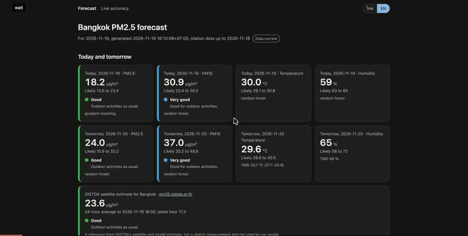

# Results and lessons

A summary of what the Bangkok forecast does, how well it works and what was learned building it. The details behind each number are in the [README](../README.md) model card. All errors are out of sample: every forecast was made by a model trained only on data from before its forecast day (walk-forward evaluation), and every model is compared with a simple rule that needs no learning.

## The problem

Bangkok's PM2.5 rises above the Thai standard (37.5 µg/m³ as a 24-hour mean) most days from December to March. Official forecasts exist, but they are city-wide or satellite-based and say little about how far to trust them. The goal was a forecast that is honest about its own error: published only where it beats the obvious rules, with a range, and scored against what was measured every day after publication.

## What it publishes

| Output | Horizon | Where |
|---|---|---|
| City PM2.5, PM10, temperature, humidity | Today and the next six days, daily mean with a range, and the chance PM2.5 goes above the standard | Dashboard, API, Power BI, Firebase |
| City PM2.5 and PM10 by hour | Up to 23:00 tomorrow, updated at about 07:30, 13:00 and 19:00 | Dashboard, API, Power BI |
| PM2.5 per station (20 stations), PM10 per station (8) | Today and the next six days, with the chance PM2.5 goes above the standard | Station map, a page per station, API, Power BI |
| City monthly means | The next three months | Dashboard, API |

## How well it works

Walk-forward MAE of the published method against the best simple rule (yesterday's value for the first two days, the mean of the last seven days after that), training run of 20 November 2026, about 1,150 days for air quality and 1,650 for weather:

| Target | Today | Tomorrow | In 3 days | In 6 days |
|---|---|---|---|---|
| PM2.5 (µg/m³) | 3.09 vs 3.45 | 4.28 vs 5.29 | 4.51 vs 5.75 | 5.04 vs 5.82 |
| PM10 (µg/m³) | 4.61 vs 4.90 | 6.43 vs 7.47 | 6.83 vs 8.24 | 7.80 vs 8.58 |
| Temperature (°C) | 0.51 vs 0.59 | 0.64 vs 0.86 | 0.77 vs 0.98 | 0.83 vs 1.03 |
| Humidity (%) | 2.96 vs 3.45 | 3.70 vs 4.90 | 4.20 vs 5.61 | 4.90 vs 6.18 |

The model removes 10 to 30 % of the error of the best rule. The gain is smallest for today, where yesterday's value is already a strong forecast, and largest a few days out, where the weather forecast for the target day carries information the rules cannot. Each slot is published only if it beats every rule by at least 1 % over all folds and over the newest 90 days; a slot that fails publishes the best rule instead (none did in this run).

**Hourly.** One model covers every hour to the end of tomorrow. Later runs see more of the day and do better, also for tomorrow:

| Run | Hours known | MAE PM2.5 | Same hour yesterday | Tomorrow's hours |
|---|---|---|---|---|
| Morning | to 03:00 | 3.67 | 4.92 | 4.42 |
| Afternoon | to 09:00 | 3.42 | 4.77 | 4.03 |
| Evening | to 16:00 | 3.21 | 4.54 | 3.51 |

**Stations.** One pooled model per horizon covers all 20 stations. PM2.5 tomorrow: MAE 4.63 against 5.61 for each station's own yesterday and 5.41 for giving every station the city forecast; in 6 days 5.54 against 6.97 and 5.98. PM10 at 8 stations: 6.48 tomorrow against 8.14 and 8.09. All 14 station slots pass the gate.

## Ranges and chances

Each forecast has a range meant to hold 80 % of outcomes. Six ways of sizing it compete in every slot: by season or by forecast level, calibrated on all history, the newest two years or the newest year. Each is checked on the newest year; among those within 7 points of 80 %, the sharpest is published. Because the newest year also scores the winner, the same choice is repeated without it, and that method's newest-year coverage is the honest figure:

| Slot | Old method | Published (chosen on the newest year) | Chosen a year earlier |
|---|---|---|---|
| PM2.5 today | 90 % held | 81 %, 8.7 µg/m³ wide | 90 % |
| PM2.5 tomorrow | 86 % | 83 %, 14.1 µg/m³ | 83 % |
| Humidity today | 69 % | 84 % | 69 % |
| Humidity tomorrow | 70 % | 81 % | 72 % |

PM ranges hold up. Humidity ranges do not: chosen a year ago, they would have held about 70 %. Humidity errors grew in the newest year, so the published figure is optimistic until live coverage confirms it.

The PM2.5 forecast also says how likely the day is to go above the colour-band edges of 25 and 37.5 µg/m³ (the Thai standard), from how past forecasts at the same level missed. Each edge is published only where it beat quoting the historical rate on the newest year: above the standard, Brier 0.027 against 0.054 for today and 0.049 against 0.054 for tomorrow; above 25, 0.070 against 0.209 for today. With only 18 days above the standard in that year, that chance is a rough guide. Published chances are scored every day against what was measured.

## What was learned

- **Beat the baseline or say so.** A promotion gate per forecast slot keeps a model off the page unless it beats persistence, the weekly mean and the same weekday by 1 %. Several slots failed it at times (temperature today, humidity today, PM10 in five days), and the published forecast fell back to the rule without anyone noticing a problem.
- **The weather forecast for the target day matters most.** Adding the JMA forecast as it was issued before each target day (Open-Meteo Previous Runs) cut PM2.5 tomorrow from 4.55 to 4.28 and temperature tomorrow from 0.83 to 0.64 °C. Using the observed weather instead would have looked better in testing and failed in production.
- **Plausible features can hurt.** Regional fire power weighted by wind direction made every slot slightly worse, including the haze season it was meant to help. It is not in the code.
- **Score the selection, not only the winner.** Picking the best of six range methods on one year and reporting its coverage on that year made humidity look fixed (84 %). Making the same choice a year earlier showed about 70 %.
- **One range for the year is wrong half the year.** A single 80 % range held only 63 % of outcomes in the haze season and 94 % in the rainy season. Calibrating on all history also hid drift: humidity ranges held 70 % until they were calibrated on the newest year.
- **Small operational details decide whether it works.** The TMD forecast publishes after the morning job starts, station hours arrive two to three hours late, and GitHub starts scheduled jobs up to 40 minutes late. Each needed its own fix (an afternoon TMD refresh, a known-hour per hourly model, a later Power BI refresh).
- **Watch the outputs, not just the jobs.** A job can succeed and still publish nothing new. The health check reads the published files and the database back, three times a day, and opens a GitHub issue when anything is stale or a live range holds under 65 % of outcomes. A weekly issue summarises the week's scores.
- **A safeguard can freeze an old model.** To stop churn, a published model was replaced only after 14 days it had never trained on. When the weather forecast features arrived, the better models could not replace seven older ones (PM2.5, PM10 and temperature today and tomorrow, humidity tomorrow), and the live scores showed it: temperature tomorrow missed by 1.5 °C in a warm week where the new model missed by 0.7. A model trained on other features is now replaced as soon as the candidate passes the gate, and the health check reports any model left on an older feature list.
- **A gate needs a second candidate.** PM10 in four and six days fell back to the weekly mean because the candidate with the lower all-fold error lost the newest 90 days, while the other candidate beat every rule on both. Trying it before falling back put a model back on both days.
- **Keeping the old model must not skip the other candidates.** The gate tried the next candidate only when no model was published, so four slots two to six days after today kept models from 17 November while another candidate beat every baseline. Every candidate is now tried before the old model is kept. A blend of half the model and half the weekly mean then put PM10 three to five days ahead back on a model.
- **A model of the level drifts towards the usual season.** November 2026 ran cleaner than earlier years, and the day-before PM2.5 forecast sat at 24 to 27 µg/m³ while the measured days were 14 to 19. The forecast inputs matched the stored data, so the pipeline was not at fault. Modelling the change from the last known value cut the bias of PM2.5 tomorrow from 1 October from +3.0 to +1.1 µg/m³ and helped today to two days after tomorrow over all folds; further ahead the level model stays better.

## Architecture in one paragraph

GitHub Actions runs everything. A `data` branch holds the medallion layers (bronze raw CSV, silver checked daily data, gold forecasts and scores) and the models, rewritten as one commit per run. The dashboard (Next.js static export on Azure App Service and Blob Storage) and the API (Azure Functions) read that branch directly. The daily job also loads the layers into Azure SQL, which a Power BI report imports each morning. Every Azure part is optional and can be deleted without stopping the forecast.

## Limits

- Five years of station data hold only five haze seasons.
- The city PM10 value rests on three stations.
- The reported model error is slightly optimistic, because the better of two candidate models is chosen on the same walk-forward results.
- Live scores for the later days, the hourly runs and the stations started in November 2026, so for now the walk-forward results are the better guide.
- Until 20 November 2026 seven daily slots published models without the weather forecast features (see "A safeguard can freeze an old model"), so live scores before 21 November understate the models described here.
